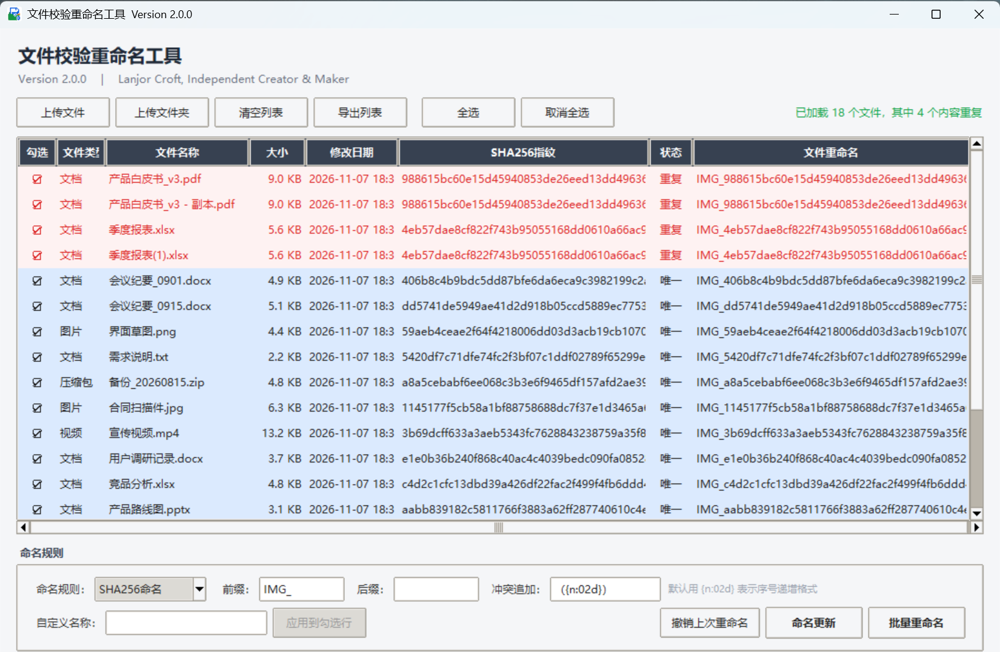

# 文件校验重命名工具

**用 SHA-256 判断文件是不是真的重复，再按规则批量改名 —— 全程本地运算，不联网、不上传。**

一个 Windows 桌面小工具，把「查重 → 改名 → 留痕」三件事合到一张表格里完成：
导入文件即可看到每个文件的完整哈希指纹，内容重复的行自动标红；
改名可先预览再执行，执行后能一键撤销，每一步都写进 CSV 日志。

| 项目 | 说明 |
| --- | --- |
| **当前版本** | `2.0.0` |
| **运行平台** | Windows 10 / 11（64 位） |
| **运行时依赖** | 无（纯 Python 标准库实现，已打包为独立 exe） |
| **界面语言** | 简体中文 |
| **作者** | Lanjor Croft |
| **许可** | 个人项目，见文末 |



> 截图说明：导入 18 个文件后，4 个内容重复的文件整行标红；勾选的行淡蓝高亮；
> 底部已按「SHA256 命名 + 前缀 `IMG_`」生成右侧预览列 —— 此时**磁盘上的文件还没有任何改动**。

---

## 目录

- [它解决什么问题](#它解决什么问题)
- [功能](#功能)
- [操作流程](#操作流程)
- [下载与安装](#下载与安装)
- [数据与隐私](#数据与隐私)
- [常见问题](#常见问题)
- [从源码运行](#从源码运行)
- [自己打包](#自己打包)
- [已知限制](#已知限制)
- [许可](#许可)

---

## 它解决什么问题

**一、判断两个文件是不是同一份**

`报告.pdf` 和 `报告(1).pdf` 长得一样，可能是同一份拷贝，也可能改过一版。看大小、看修改时间都不靠谱。
本工具直接计算 SHA-256 —— 哈希相同，就是字节级完全一致，没有例外。

**二、批量改名，且改之前能看见结果**

要去掉文件名里的客户名、项目名再对外发送，或者统一成哈希 / UUID 命名做归档。
手工改几十上百个既慢又容易错，命令行写循环出错更难查。
本工具把「预览」和「执行」拆成两个按钮：先看清每一个新名字，确认无误才落盘。

**三、改完能回退，也能追溯**

`os.rename` 是不可逆操作，改错一次可能毁掉整个目录的关联关系。
本工具每次执行都会留一份 CSV 映射表（原路径 → 新路径 → 结果），并支持一键撤销最近一次批量操作。

与常见做法对比：

| | 资源管理器手动改 | 命令行脚本 | 本工具 |
| --- | --- | --- | --- |
| 判断内容是否重复 | 靠肉眼、看大小 | 需自己写哈希脚本 | 自动计算，重复行标红 |
| 批量改名 | 一次一个 | 需写循环 | 勾选 + 选规则，一次成型 |
| 执行前预览 | 无 | 无 | 有（预览与落盘彻底分离） |
| 改错能否回退 | 部分可 Ctrl+Z | 不能 | 一键撤销 + CSV 日志 |
| 非法文件名拦截 | 报错中断 | 报错中断 | 执行前统一校验并跳过 |

---

## 功能

### 校验

| 功能 | 说明 |
| --- | --- |
| SHA-256 指纹 | 分块读取（每块 1 MB），取完整 64 位哈希；几 GB 的大文件也不会撑爆内存 |
| 重复检测 | 哈希相同即判定内容一致，整行红字 + 浅红底，`状态` 列显示「唯一 / 重复」 |
| 文件信息 | 文件类型（按扩展名归类）、大小（自动换算 KB/MB/GB）、修改日期 |

### 重命名

| 功能 | 说明 |
| --- | --- |
| 三种命名规则 | `SHA256命名`（完整哈希）/ `UUID命名`（随机 UUID）/ `自定义命名` |
| 前缀 / 后缀 | 任意文本，加在主体名前后；扩展名始终自动保留 |
| 冲突处理 | 目标名已存在时自动追加序号，序号格式可配，默认 `（{n:02d}）` → `（01）`、`（02）` |
| 自定义命名 | 输入一个名字，点「应用到勾选行」批量套用，重名自动追号 |
| 预览与执行分离 | 「命名更新」只生成表格里的预览；「批量重命名」才真正改磁盘文件 |
| 一键撤销 | 「撤销上次重命名」把最近一次批量操作整体回退 |
| 操作日志 | 每次执行写一份 CSV，记录原路径、新路径、执行时间与结果 |
| 文件名合法性校验 | 执行前拦截 `\ / : * ? " < > \|`、`CON`/`PRN`/`NUL` 等保留名、末尾空格或点、超长路径，不合法项跳过并计入结果 |

### 表格与数据

| 功能 | 说明 |
| --- | --- |
| 8 列信息 | 勾选 · 文件类型 · 文件名称 · 大小 · 修改日期 · SHA256 指纹 · 状态 · 文件重命名 |
| 点击表头排序 | 升序 / 降序切换 |
| 多选 | 单行勾选、Shift 连选、全选 / 取消全选 |
| 批量导入 | 多选文件，或递归导入整个文件夹（无权限的子目录自动跳过，不会中断） |
| 增量刷新 | 单行勾选只重绘该行，不重建整张表，几千个文件也不卡 |
| 导出清单 | 勾选状态、类型、大小、时间、哈希、新旧文件名导出为 CSV，UTF-8-BOM 编码，Excel 双击不乱码 |

---

## 操作流程

界面分为三区：**工具栏**（导入/清空/导出/全选）、**表格**（文件与哈希）、**命名规则面板**（规则与执行）。

1. 点 **上传文件** 多选，或 **上传文件夹** 递归导入 —— 状态栏显示读取进度
2. 看红色行 —— 这些是内容重复的文件，可排序、可勾选
3. 在底部选择命名规则，填写前缀 / 后缀 / 冲突序号格式
4. 点第一列 `☐` 勾选要处理的文件（可 Shift 连选，或点「全选」）
5. 点 **命名更新** → 右侧「文件重命名」列出现预览，**此时磁盘文件完全没有改动**
6. 核对无误后点 **批量重命名** → 确认弹窗 → 真正改名
7. 如果改错了，点 **撤销上次重命名** 整体回退

> 第 5 步和第 6 步分开，是整个工具最重要的设计：让你在落盘前永远有一次反悔的机会。

---

## 下载与安装

到本仓库的 **发行版（Releases）** 页面下载，三种形态任选：

| 形态 | 文件名 | 适用场景 |
| --- | --- | --- |
| 安装包 | `文件校验重命名工具_v2.0.0_安装包.exe` | 想要开始菜单 / 桌面快捷方式，能像普通软件一样卸载 |
| 目录绿色版 | `文件校验重命名工具_v2.0.0.zip` | 免安装。解压后双击目录里的 exe 即可，整个文件夹拷走换电脑也能用 |
| 单文件版 | `文件校验重命名工具_v2.0.0_单文件绿色版.exe` | 只有一个 exe，方便随手发给别人；启动稍慢 1–3 秒。若发行版未附带，可按下方[打包命令](#自己打包)自行生成 |

**首次运行提示「Windows 已保护你的电脑」？**
这是 SmartScreen 对未做数字签名的程序的统一提示，不是病毒拦截。点「更多信息」→「仍要运行」即可。
程序不联网、不写系统目录（安装版除外）、不创建开机启动项，可以自行核对哈希后再运行。

**卸载**：安装版在「设置 → 应用」里正常卸载；绿色版直接删除所在文件夹。

---

## 数据与隐私

程序**全部运算在本机完成**：

- 不发起任何网络请求，不上传文件名、哈希或文件内容
- 不收集任何使用数据
- 除安装版由安装程序写入卸载信息外，**不写注册表**
- 不创建开机启动项、不驻留后台

需要落盘的数据只有两类，都在你自己选的路径下：

| 内容 | 位置 |
| --- | --- |
| 重命名日志 | `%LOCALAPPDATA%\FileVerifyRename\logs\rename_YYYYMMDD_HHMMSS.csv` |
| 导出的清单 | 点「导出列表」时由你选择的路径 |

日志内容形如：

```csv
序号,原文件名,新文件名,原路径,新路径,结果
1,a.jpg,3f2a...c7.jpg,D:\in\a.jpg,D:\in\3f2a...c7.jpg,成功
2,b.jpg,3f2a...c7（01）.jpg,D:\in\b.jpg,D:\in\3f2a...c7（01）.jpg,成功
```

---

## 常见问题

**Q：能处理多大的文件？**
哈希是分块读取的，单文件几 GB 也没问题，内存占用恒定。耗时取决于磁盘速度：普通机械硬盘约 100–200 MB/s，10 GB 文件大概需要一分钟。

**Q：上万个文件会卡吗？**
表格刷新已改为增量更新（单行变化只重画该行），但首次导入仍需逐个计算哈希，一万个文件通常是几分钟。导入过程中界面不会假死，状态栏有进度。

**Q：撤销能退多步？**
只保留**最近一次**批量操作。更早的记录在日志 CSV 里，可以人工比对后手动改回。这是刻意的取舍：只留一步，状态简单、内存可控。

**Q：为什么冲突序号是 `（01）` 而不是 `#1`？**
中文全角括号在资源管理器里更易读，且能避免与文件名里本来就有的 `#` 混淆。序号格式在面板里可以随时改。

**Q：哈希相同就说明文件安全吗？**
不。SHA-256 只能证明「两份文件一模一样」，不能证明文件本身可信。本工具是查重工具，不是杀毒工具。

**Q：重命名会破坏正在同步的网盘文件吗？**
建议先暂停同步（OneDrive / 坚果云等）再操作，避免同步冲突。工具本身不做任何网络操作。

**Q：可以撤销已经关闭程序的那次重命名吗？**
不可以。撤销依赖内存中的操作记录，程序关闭后失效。但日志 CSV 还在，可按记录手工还原。

---

## 从源码运行

需要 Python 3.9+ 且带 `tkinter`（官方安装包默认包含）。

```bat
python main.py
```

**零第三方依赖**，不需要 `pip install`。

如果报 `ModuleNotFoundError: No module named 'tkinter'`，说明当前用的是精简版 / 嵌入式 Python，换一个完整安装的解释器：

```bat
"C:\Users\<你>\AppData\Local\Programs\Python\Python313\python.exe" main.py
```

### 仓库结构

```
FileVerifyRename/
├── main.py                     # 主程序（Tkinter 单文件实现，唯一入口）
├── FileVerifyRename.spec       # PyInstaller 打包配置（onedir 目录模式）
├── installer.iss               # Inno Setup 安装包脚本
├── requirements.txt            # 仅打包需要 pyinstaller；运行零依赖
├── assets/
│   ├── logo.ico                # 应用图标（窗口 / exe / 安装包共用）
│   └── screenshot-main.png     # README 界面截图
├── tests/
│   └── test_e2e.py             # 端到端自测（30 项断言）
└── legacy/                     # 早期模块化草稿，未被引用，仅存档
```

### 自测

```bat
python tests\test_e2e.py
```

在临时目录里完整跑一遍真实流程：导入 → 查重 → 预览 → 非法名校验 → 重命名（含同哈希追号）→ 撤销 → 排序 → 清空。
共 30 项断言，全通过时打印 `结果：通过 30 项，失败 0 项`，退出码 0，结束后自动清理临时文件。

---

## 自己打包

### 一键打包

仓库的**上一级目录**放着 `build.bat`（它需要同时读写构建产物目录，所以不放在代码仓库内）：

```bat
build.bat          :: 同时产出目录版 zip + 安装包 exe
build.bat /zip     :: 只出目录版 zip
build.bat /iss     :: 只出安装包 exe
build.bat /clean   :: 先清空输出目录再打包
```

脚本会自动探测带 `tkinter` 的 Python、缺 PyInstaller 时自动安装、定位 Inno Setup 的 `ISCC.exe`，全程约 30 秒。

### 手动打包

```bat
pip install -r requirements.txt

:: 目录版（可作为安装包的数据源）
pyinstaller --noconfirm --clean FileVerifyRename.spec

:: 单文件版
pyinstaller --noconfirm --clean -F -w -n 文件校验重命名工具 ^
            --icon assets/logo.ico --add-data "assets/logo.ico;." main.py

:: 安装包（需先有目录版产物）
"%ProgramFiles(x86)%\Inno Setup 6\ISCC.exe" installer.iss
```

`--add-data "assets/logo.ico;."` 不能省略：`--icon` 设的是 exe 外壳图标，`--add-data` 是程序运行时读取的窗口图标。单文件模式下程序从解压临时目录读图标，手动放在 exe 同级目录反而读不到。

---

## 已知限制

| 事项 | 说明 |
| --- | --- |
| 撤销仅一步 | 多级历史不保留，更早记录见日志 CSV |
| 无数字签名 | 首次运行会有 SmartScreen 提示 |
| 未做虚拟滚动 | 数万行的极端场景下表格滚动仍可能有轻微卡顿 |
| 仅 Windows | 界面基于 Tkinter，理论上可移植，但打包脚本与安装程序面向 Windows |
| `legacy/` 不可引用 | 早期模块化草稿，字段命名与 `main.py` 不一致，导入会报错，仅作存档 |

---

## 许可

个人项目，未声明开源许可。如需引用、二次分发或商用，请先联系作者。

作者：Lanjor Croft
